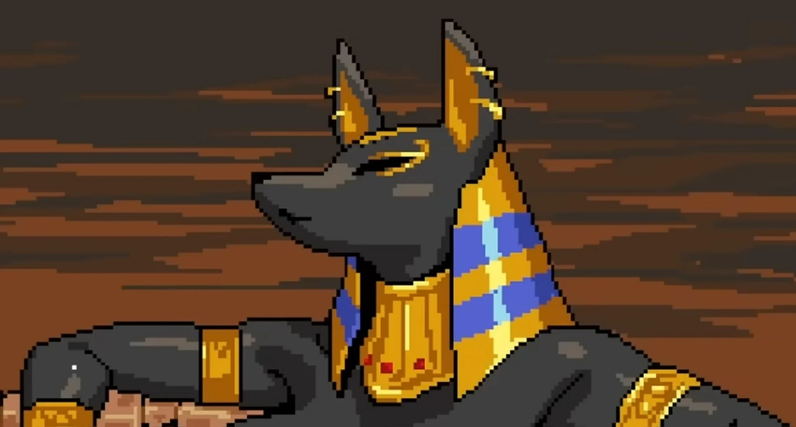
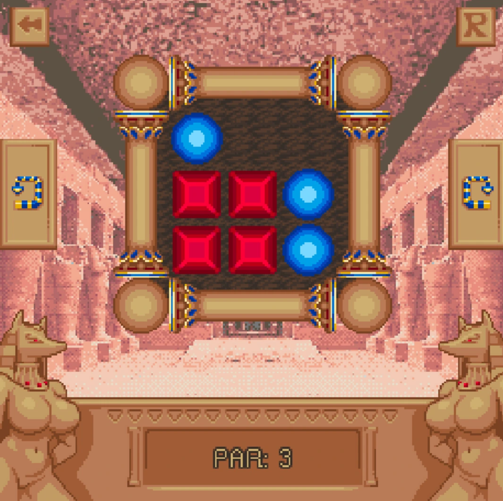
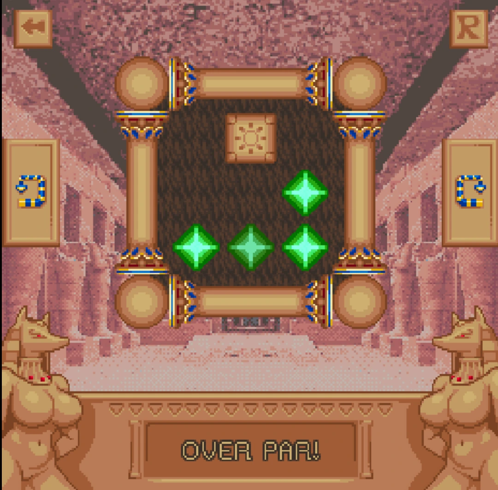

# Temple of the Jackal

[Visit Temple of the Jackal](https://templeofthejackal.com/)

## Explore the Website

Temple of the Jackal is a compact adult puzzle game set beneath an imagined Egyptian ruin. Its central rule is easy to understand: use the direction buttons on the left and right sides of the board to rotate the entire chamber, let the colored orbs fall into new positions, and bring matching colors together so they disappear. Clear the remaining orbs to complete the room and move to the next stage. The recovered build contains eighteen primary puzzle stages and two story scenes that become available through progress. It is a deliberately small game, presented in a 256-pixel square canvas, but that limitation gives the experience a tactile quality. Every orb, ledge, doorway, and torch-like color feels cut from the same old game cartridge.

This browser portal puts play before explanation. The game frame sits at the top, launches only after an adult-age confirmation, and can expand to fullscreen when you want the original pixel grid to breathe. Everything below the frame is organized for people deciding whether to play or returning after a difficult chamber: a spoiler-light overview, accurate rotation controls, a future video area, practical troubleshooting, and frequently asked questions.

The stage screen arranges the main journey as a sequence of compact rooms. Begin with the earliest available level. Later tiles record the route you have completed, while the special lower corners lead toward the story material after the relevant requirements are met.

Study the colored orbs and the platforms between them. Your aim is to make orbs of the same color touch. Because the whole chamber rotates, consider where each orb will fall under gravity rather than looking only at its current neighbor.

Press one of the direction buttons at the sides of the game board. The chamber rotates ninety degrees and loose orbs fall in the new downward direction. When matching colors meet, they activate and disappear. If a sequence leaves the remaining colors separated, reset the chamber and try the opposite order.

Remove all of the colored orbs to complete the level and continue to the next chamber. The game also tracks a par target for efficient solutions. Progress across the eighteen rooms eventually exposes two additional scenes, which are explicit and intended only for adults.

## Plan Your Visit

The opening premise follows an explorer moving deeper into an abandoned dig site. Sounds of water and fresh warmth interrupt the expected dust and silence, leading toward an impossible fountain and a jackal-headed figure. The framing borrows the visual vocabulary of tomb exploration, but the game is not a history lesson and should not be read as an accurate depiction of Egyptian religion. It is fantasy, built around a fictionalized adult Anubis-inspired character and a playful pulp-adventure tone.

Most of your active time is spent with the puzzle system rather than dialogue. The eighteen chambers provide the progression spine. Each level places colored orbs around a confined square board. Turning the entire board left or right changes the direction of gravity, sending the orbs toward new ledges and other colors. Matching orbs vanish when brought together. The visual language stays consistent, so the difficulty comes from forecasting a sequence of rotations rather than learning a new rule every few minutes. That makes the game easy to resume after a break: recognize the colors, inspect the platforms, and focus on the next turn.

The desktop release was designed around a 256 by 256 viewport. On this page, the browser build is enlarged with crisp pixel rendering instead of being stretched into a blurry rectangle. Fullscreen gives the canvas more presence, but it does not add detail that was never in the original art. This is intentional. The chunky edges, limited palette, and compressed animation are part of the game's identity.

Mouse input is the safest way to play. Click the game once after it loads so the embedded canvas has focus, then use the large direction controls on the left and right sides of the puzzle. Watch where gravity carries every orb after a ninety-degree turn. The reset control lets you restart when an early rotation traps colors apart. Keyboard number shortcuts existed in the desktop build to change window scale, but the portal handles responsive scaling for you, so those shortcuts are not important online.

If the player never advances, confirm that JavaScript and WebAssembly are allowed, then try a current desktop version of Chrome, Edge, or Firefox. Privacy extensions can block worker scripts, local storage, audio, or embedded content. The game files are delivered from the dedicated s.templeofthejackal.com game host, while strict corporate and school networks may still reject embedded game files.

Phones can display the page, yet the square game board asks for precise taps. Landscape orientation on a large phone or tablet is more comfortable. If a touch does not register, tap once in the center of the canvas to focus it and avoid browser gestures near the screen edge. Desktop remains the recommended format for solving later rooms and reading the story text.

## Visit Online

[Open Temple of the Jackal](https://templeofthejackal.com/) to explore the website and choose your next activity.
